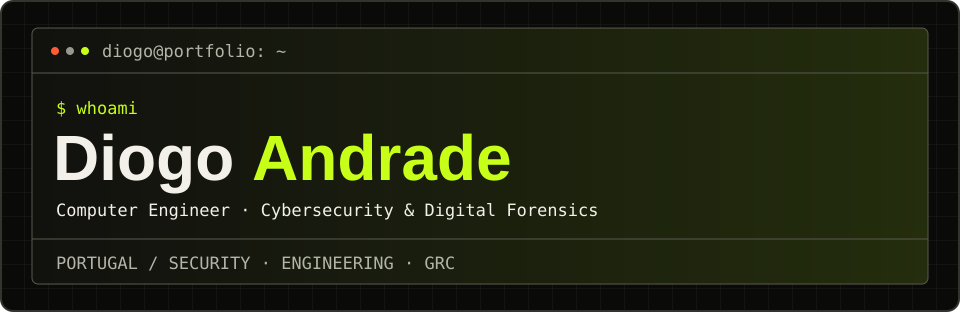
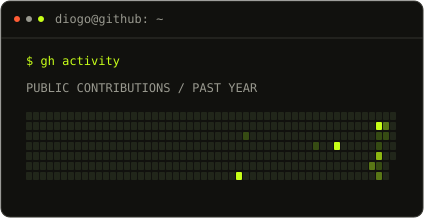
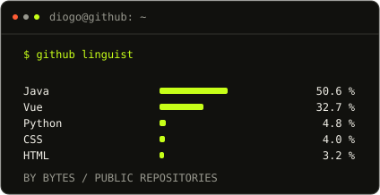

  <a href="https://diogoma2002.github.io/"><strong>Portfolio ↗</strong></a>
  &nbsp;·&nbsp;
  <a href="https://www.linkedin.com/in/diogo-andrade-851185274/">LinkedIn ↗</a>
  &nbsp;·&nbsp;
  <a href="mailto:psvdiogo@gmail.com">Email ↗</a>

## `$ whoami`

I’m a Computer Engineer based in Portugal with an MSc in Cybersecurity and Digital Forensics. I assess systems, investigate threats and turn security findings into practical improvements.

As a cybersecurity researcher, I carried out security diagnostics and maturity assessments across **80+ organisations**. I also worked as an Invited Teaching Assistant in systems administration, operating systems, databases and computer technology.

## `$ cat stack.txt`

| Area | Tools and practices |
| --- | --- |
| Security & detection | `Wazuh` `YARA` `SIEM` `Digital forensics` |
| Governance & risk | `Security assessments` `Maturity assessments` `Risk analysis` |
| Languages | `Java` `Python` `Bash` `SQL` |
| Application development | `Spring Boot` `Vue.js` `Node.js` |
| Systems & infrastructure | `Linux` `Docker` `Kubernetes` `Proxmox` `OPNsense` `Git` |

## `$ ls projects/`

| Project | Focus |
| --- | --- |
| [Risk Matrix](https://github.com/DiogoMA2002/risk_matrix) | A web application for assessing and visualising organisational risk. |
| [Blue Team Operations Lab](https://github.com/DiogoMA2002/blue-team-operations-lab) | A lab for security monitoring, with Active Directory, network segmentation and SIEM telemetry. |
| [HomeLab](https://github.com/DiogoMA2002/HomeLab) | A documented virtualised environment for experimenting with network and infrastructure design. |

## `$ cat highlights.txt`

| **80+** | **211K+** |
| :---: | :---: |
| Organisations assessed | SIEM events analysed |

## `$ gh activity`

  
  

[View my GitHub contributions and recent activity ↗](https://github.com/DiogoMA2002#contribution-activity)
